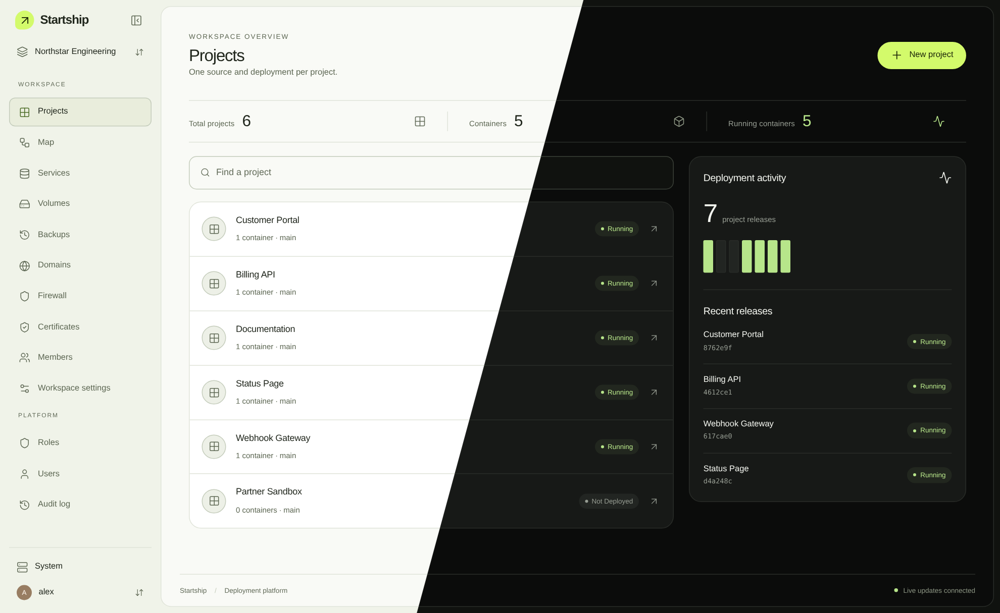

<h1 align="center">Startship</h1>

<p align="center"><strong>Deploy from Git. Run it on your own server.</strong></p>

<p align="center">
  <a href="https://github.com/sammwyy/startship/releases/latest"></a>
  <a href="https://github.com/sammwyy/startship/actions/workflows/ci.yml"></a>
  <a href="LICENSE"></a>
</p>

<p align="center">
  <a href="INSTALL.md"><strong>Install Startship</strong></a> ·
  <a href="docs/getting-started.md">Deploy your first project</a> ·
  <a href="#what-you-can-do">Explore the features</a>
</p>



Startship is a self-hosted deployment platform for web apps, APIs, and static sites. Connect a Git repository, deploy it to Docker, and put it behind a domain. Manage deployments, data, and access from one dashboard or the CLI. The Go daemon embeds the dashboard and stores its state in SQLite, so you don't need a separate web server or database to run it.

## What you can do

| Feature | What it does |
| --- | --- |
| **Deploy from Git** | Use a Dockerfile, Nixpacks, or Buildpacks, or start with one of 28 pipeline templates. Configure build, test, and health checks; a failed release leaves the previous deployment serving. Enable deploys on GitHub pushes with a signed webhook. |
| **Route traffic with HTTPS** | Route by hostname and path. Issue Let's Encrypt certificates or upload your own, and optionally redirect HTTP to HTTPS. |
| **Run services alongside your apps** | Choose from 13 service engines, including PostgreSQL, Redis, and S3-compatible SeaweedFS. Attach them through project Connections so applications can use their connection settings. |
| **Keep application data** | Mount persistent Volumes and schedule service backups. Download backups or restore a service from the dashboard or CLI. |
| **See what's running** | Use the workspace Map to see how projects, services, and volumes connect. Follow deployment activity, build and runtime logs, and routed traffic in the live dashboard. |
| **Control traffic and access** | Use workspace Firewall and WAF rules to monitor or block HTTP traffic. Native Linux deployments can opt in to the platform network firewall. Scope roles and permissions to teams and projects, and review changes in the audit log. |
| **Operate Startship** | Use the CLI locally or over HTTPS. Install the daemon as a system service or run it with Docker Compose. The systemd installer enables self-updates from the dashboard or CLI. |

## Quick start

On a Linux amd64 or arm64 server with systemd, Docker Engine with Buildx, Git, and curl, restrict inbound TCP 8080 to trusted clients before installing:

```sh
curl -fsSL https://raw.githubusercontent.com/sammwyy/startship/main/install.sh -o install.sh
sudo sh install.sh
sudo journalctl -u startshipd
```

Find the temporary administrator credentials in the logs. Open `http://localhost:8080` on the host or through a private tunnel, sign in, and change the temporary password. Keep the dashboard port off the public internet. The [installation guide](INSTALL.md) covers Docker Compose, source builds, and private remote access.

## Documentation

| I want to… | Read |
| --- | --- |
| Install, upgrade, or uninstall Startship | [Installation](INSTALL.md) |
| Connect a repository, deploy, and add a domain | [First deployment](docs/getting-started.md) |
| Configure listeners, storage, and certificates | [Daemon configuration](docs/configuration.md) |
| Manage Startship from a terminal | [CLI guide](docs/cli.md) |
| Connect AI assistants or automation with tokens | [Access tokens and MCP](docs/mcp.md) |
| Customize build, test, or deploy stages | [Project pipelines](docs/pipelines.md) |
| Configure WAF rules or the optional network firewall | [Firewall and WAF](docs/firewall.md) |
| Integrate with dashboard live updates | [Live API](docs/live-api.md) |
| Build and test a change locally | [Development](docs/development.md) |

## License

Startship is licensed under the [Apache License 2.0](LICENSE).
